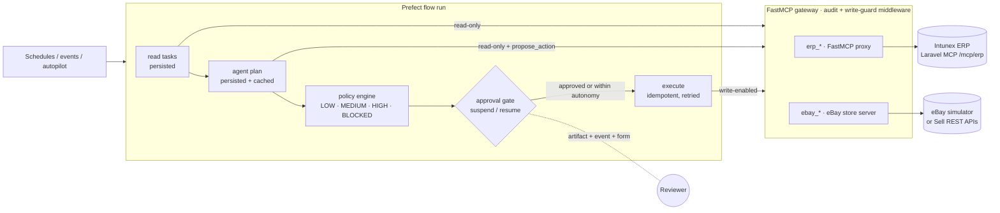

# agentic-ebay-store

[](https://github.com/jeremiahcarreon/agentic-ebay-store/actions/workflows/ci.yml)

An eBay store run by an AI agent, built on **Prefect** and **FastMCP**.

An existing production ERP MCP server ([Intunex](#connecting-the-real-intunex-erp), a Laravel
MCP endpoint) is wrapped with a FastMCP proxy and combined with an eBay store MCP server into
one gateway. A tool-using agent runs every part of the store (inventory, fulfilment, buyer
messages, returns, reputation, pricing, promotions, listings and store health) through
**durable Prefect flows**. Anything that touches buyers, money or listings goes through a
deterministic **policy engine**. Above the autonomy threshold it also goes through a
**human approval gate**, which suspends the run until someone decides.

---

## Contents

1. [In plain English](#in-plain-english)
2. [How it works](#how-it-works)
3. [What the agent does, flow by flow](#what-the-agent-does-flow-by-flow)
4. [Guardrails: policy, approvals, memory, audit](#guardrails-policy-approvals-memory-audit)
5. [Durability and reliability](#durability-and-reliability)
6. [The agent](#the-agent)
7. [The MCP gateway](#the-mcp-gateway)
8. [Interfaces: where people see and control it](#interfaces-where-people-see-and-control-it)
9. [Try it](#try-it)
10. [CLI reference](#cli-reference)
11. [Configuration](#configuration)
12. [Connecting the real Intunex ERP](#connecting-the-real-intunex-erp)
13. [eBay backends and current limits](#ebay-backends-and-current-limits)
14. [Roadmap](#roadmap)
15. [Project layout and development](#project-layout-and-development)

---

## In plain English

Running an eBay store is a lot of small, repetitive jobs that never stop. You answer "where
is my order?", copy tracking numbers into eBay, keep stock counts right so you don't oversell,
deal with returns, reply to bad feedback, nudge prices and write listings. Most of these jobs
need facts from the business system, such as what is actually in the warehouse, whether the
order shipped and what the part fits.

This project is a digital store assistant that does those jobs around the clock. It looks up
the real facts in the business system first. Then it **suggests** what to do. Safe, routine
changes (for example "eBay says 2 in stock, the warehouse says 14") happen automatically.
Anything a customer will read, or anything that costs money, waits for a person to tap
**approve**. Everything it does is written down so you can check its work later.

## How it works



Every flow follows the same five steps:

1. **Gather facts.** Read-only tasks call the gateway, for example "list paid eBay orders"
   and "find each one in the ERP". The results are persisted, so a resumed run sees exactly
   what the reviewer saw.
2. **Plan.** The agent gets the facts and an objective. It can call any *read* tool to
   investigate further, and it returns **proposals**. A proposal is a specific write tool,
   its exact arguments, a one-line rationale and the evidence it relied on.
3. **Assess.** The policy engine gives every proposal a risk level using fixed, tested
   rules. The agent never sets its own risk.
4. **Gate.** Blocked proposals are dropped. Proposals within the autonomy level go straight
   through. The rest wait for a person.
5. **Execute.** Approved proposals run through a separate write-enabled gateway. Each run is
   retried on network errors and recorded so it can never run twice. A results table is
   published to the Prefect UI.

## What the agent does, flow by flow

Each domain is its own Prefect flow and deployment, with its own schedule, history and logs.

### `inventory-sync`: stock counts never drift (every 15 min)
- **Reads:** active eBay listings, then ERP `check_stock` for all their SKUs in one call. ERP
  `available_to_sell` is already net of other customers' reservations, backorders and
  exchange holds.
- **Proposes:** `ebay_update_quantity` wherever eBay and the ERP disagree. Listed quantity is
  capped at 25 to limit exposure if a sync is ever missed.
- **Risk:** LOW when the number came from the ERP, so it runs automatically. Zeroing a best
  seller (10+ sold in 30 days) is MEDIUM, because it drops the listing out of search.

### `fulfillment-sync`: tracking gets to eBay (every 30 min)
- **Reads:** paid, unshipped eBay orders. Each one is looked up in the ERP by eBay order id,
  and only exact matches count.
- **Proposes:** `ebay_mark_shipped` with the ERP's carrier and tracking number when the ERP
  shows the order shipped. Orders with no ERP match are logged and nothing is made up.
- **Risk:** LOW when the tracking came from the ERP. Any tracking number that can't be traced
  to the ERP is HIGH, because fake tracking damages seller metrics.

### `buyer-messages`: every question answered from real data (every 10 min, and on demand)
- **Reads:** unanswered buyer messages. For each one it finds the ERP order (by order id, or
  by buyer username) and works out the SKU from the text or the listing. Then it pulls the
  product's specs, fitment and staff knowledge notes, plus stock and incoming purchase
  orders. It also reads how staff edited earlier drafts (`get_reply_feedback`), so replies
  match the house voice.
- **Proposes:** `ebay_send_buyer_message` for each message. When something can't be
  confirmed, such as an uncertain fitment, it proposes `erp_ask_product_expert` and sends a
  holding reply instead of guessing.
- **Examples:** "Where is my order?" gets the carrier and tracking number. "Does RAD-259 fit
  my 1966 Mustang?" gets the catalogued fitment, plus the restock date from the incoming PO
  if the part is out of stock.
- **Risk:** MEDIUM (customer-facing), so it needs approval by default. Promising a refund,
  replacement or compensation is HIGH. Mentioning cost, margin or wholesale is BLOCKED.
- **Event trigger:** when `store-health` reports unanswered messages, this deployment starts
  immediately instead of waiting for its schedule.

### `returns-desk`: returns decided with evidence (hourly)
- **Reads:** open return requests, the eBay order (for its age) and the ERP order (for
  fulfilment stage and tracking).
- **Proposes:** accept seller-fault returns (damaged, defective, not as described, wrong
  item) and then refund. Other returns are accepted inside the 30-day window. A decline is
  proposed only with a stated reason.
- **Risk:** accepting is MEDIUM and declining is HIGH (case escalations hurt the defect
  rate). Refunds over $75 (configurable) are HIGH. A refund can only run after its return is
  accepted, so rejecting the acceptance also stops the refund.

### `reputation`: feedback handled (daily 09:00)
- **Proposes:** positive feedback for buyers on delivered orders that don't have any yet
  (LOW). Also one calm, factual public reply to each unanswered negative feedback, which
  mentions the accepted return if there is one and promises nothing more (HIGH, because eBay
  allows exactly one permanent reply).

### `pricing`: small, defensible price moves (daily 06:00)
- **Reads:** price, stock and 30-day views, watchers and sales for each active listing, plus
  the ERP list price and dealer tier prices. SKUs already in a promotion are skipped.
- **Rules (used when no LLM is available):**
  - Less than 7 days of stock left at the current sales rate: **+5%**.
  - Watchers are at least 2% of views but conversion is under 1.5%: **−4%**, to turn
    watchers into buyers.
  - More than 10% above the ERP list price: **back to list**.
  - Out-of-stock listings are left alone, and prices are rounded to .95.
- **Price floor:** the *highest* dealer tier price. Retail on eBay must never undercut what
  dealers pay, and anything below the floor is BLOCKED.
- **Risk:** moves of 5% or less are LOW, up to 15% are MEDIUM, and anything larger is HIGH.

### `promotions`: clear slow stock (Mondays 07:00)
- **Proposes:** at most one markdown sale that groups slow movers (more than 180 days of
  stock and at least 10 units), 10% off for 14 days. Items that already have a promotion are
  skipped, so re-runs do nothing.
- **Risk:** markdowns up to 15% are MEDIUM, deeper ones are HIGH. The store itself rejects
  anything outside eBay's 5–80% range.

### `listing-builder`: drafts become complete listings (daily 06:30)
- **Reads:** draft listings, plus each part's ERP product record (specs, fitment, knowledge
  notes) and its stock.
- **Proposes:** `ebay_upsert_listing` with a keyword-rich title of 80 characters or less, an
  HTML description (specs, every fitting vehicle, staff notes), item specifics, the ERP list
  price and a stock-capped quantity. It then proposes `ebay_publish_listing`. Parts that are
  out of stock are skipped.
- **Risk:** publishing is HIGH, so a person approves every new live listing. Approved
  publishes run in a **transaction**: if publishing fails, the listing is restored exactly as
  it was.

### `store-health`: the scoreboard (hourly)
- Publishes the store KPIs as Prefect artifacts: active listings, stock-outs, orders waiting
  to ship, unanswered messages, open returns, feedback score, 30-day sales and conversion.
- Emits an `ebay.store.kpi.breached` event for each KPI outside its threshold:
  - unanswered messages > 0
  - orders waiting to ship > 5
  - out-of-stock listings > 0
  - open returns > 2
  - feedback score < 98%

  Automations can page someone or start a fix flow from these events.

### `store-autopilot`: everything, in order (on demand)
- Runs inventory → fulfilment → messages → returns → reputation → pricing → promotions →
  listings → health.
- Each domain is isolated, so one failure is recorded and the rest still run.
- With `use_deployments=True` it starts each domain's *deployment* instead. Every domain can
  then wait at its own gate without holding anything up.

## Guardrails: policy, approvals, memory, audit

### Risk levels
| Level | Meaning | Default handling |
|---|---|---|
| LOW | Mechanical, ERP-backed, reversible | Executes automatically |
| MEDIUM | Customer-facing or commercial, within policy | Waits for a person (or automatic if autonomy is raised to MEDIUM) |
| HIGH | Money out, permanent or public, or big moves | Always waits for a person |
| BLOCKED | Against policy | Never executes; recorded |

### Policy rules (`src/ebay_agent/policy.py`)
| Action | Rule |
|---|---|
| Update quantity | LOW if from ERP; MEDIUM if not, or if zeroing a best seller |
| Update price | LOW ≤5%, MEDIUM ≤15%, HIGH >15%, **BLOCKED below dealer floor** |
| Mark shipped | LOW with ERP tracking, else HIGH |
| Send buyer message | MEDIUM; HIGH if it promises refund/replacement/compensation; **BLOCKED if it mentions cost/margin/wholesale** |
| Accept / decline return | MEDIUM / HIGH |
| Issue refund | MEDIUM up to $75, else HIGH |
| Upsert listing | MEDIUM; **BLOCKED if title > 80 chars** |
| Publish / end listing | HIGH |
| Leave buyer feedback | LOW |
| Respond to feedback | HIGH (permanent and public) |
| Markdown promotion | MEDIUM ≤15%, else HIGH |
| ERP draft reply / ask product expert | LOW (a person reviews these in the ERP anyway) |
| Anything unrecognised | HIGH |

All thresholds can be set with environment variables (`EBAY_AGENT_POLICY__*`).

### Approval gates (`src/ebay_agent/workflow/approvals.py`)
When proposals need a person, the gate:
1. Publishes an **"Approval needed" artifact**: a table of every pending proposal with its
   id, risk badge, exact action, rationale and evidence.
2. Emits `ebay.agent.approval.requested`, which a Prefect Automation can route to Slack,
   email or SMS.
3. **Suspends** the run (inside a deployment) or pauses it (ad-hoc run) and waits for a
   **ReviewDecision** form: *approve all*, or a list of approved ids, plus reviewer name and
   a note. Anything not approved is rejected.
4. Emits `ebay.agent.approval.decided` and records the decision.

If nobody answers within 24 hours (configurable), the gate rejects everything.
`EBAY_AGENT_APPROVAL_MODE=auto` lets policy decide alone (demos). `deny` rejects
everything that needs a person, so only LOW-risk changes run.

### Reviewer memory (`src/ebay_agent/workflow/decisions.py`)
Every decision is appended to `decisions.jsonl`, and the agent learns from it in two ways:
- Recent decisions and reviewer notes for the domain are added to its context, for example
  *"check transmission type before confirming fitment"*.
- A change a person rejected in the last 7 days is **not proposed again**, so a 10-minute
  schedule doesn't keep showing the reviewer the same thing.

### Audit trail
- `audit.jsonl` holds every gateway tool call: time, session (agent / executor /
  external), tool, arguments, success or failure, and latency.
- Prefect keeps every flow run, task run, log line, artifact and event.

## Durability and reliability

| Concern | Mechanism |
|---|---|
| Waiting hours for a human without holding a server | Deployment runs **suspend** at the gate. Resuming re-runs the flow and every finished step loads its saved result. |
| Resuming must not re-ask the model and get a different answer | The plan task is persisted and cached per flow run, and the reads are too. A resumed run reaches the **same** gate key and receives the submitted decision. |
| Nothing executes twice | Proposal ids are content hashes, and execution is cached per *flow run + proposal id*. Simulator writes are idempotent. |
| Half-done listing changes | Prefect **transaction** with an `on_rollback` hook that restores the pre-change listing. |
| Flaky networks / API hiccups | Reads retry 1s/5s/15s and writes retry 2s/10s/30s, with jitter. Business errors (for example "order not paid") fail fast without retrying. |
| eBay rate limits | Global concurrency limit `ebay-store-writes` across all runs and workers. Each deployment also has `concurrency_limit=1`. |
| One area failing | The autopilot isolates each domain flow. |

This was verified against a live Prefect server. A served `buyer-messages` run suspended at
its gate and released its process. After approval it resumed with every ERP read and the
agent plan in state `Cached`, the gate returned the decision, and each reply was sent
exactly once:

```
Flow run 'curly-oryx' - Suspending flow run, execution will be rescheduled when this flow run is resumed.
   ... reviewer approves ...
Task run 'read erp_find_order' - Finished in state Cached(type=COMPLETED)
Task run 'plan messages' - Finished in state Cached(type=COMPLETED)
Flow run 'curly-oryx' - Gate 'Buyer messages': 2 approved, 0 rejected by jeremiah
Task run 'execute ebay_send_buyer_message' - Executed ebay_send_buyer_message(reply_to_message_id='MSG-1001', ...)
Flow run 'curly-oryx' - Finished in state Completed()
```

## The agent

Two interchangeable planners produce the same kind of proposals, and both are governed the
same way.

- **LLM planner** (`agent/llm.py`) is used when Anthropic credentials are available. It runs
  a Messages API tool-use loop with adaptive thinking and configurable effort. It is offered
  **only the read tools** on the gateway plus `propose_action`, which only accepts the write
  tools allowed for that task. Its system prompt sets the rules: look things up before
  acting, never guess stock, ship dates, tracking or fitment, never mention cost or margin,
  never promise refunds, and ask the product expert when unsure. Refusals, `pause_turn` and
  turn limits are handled, and oversized tool results are trimmed.
- **Rule-based planners** (`@heuristic` functions in each flow) are used when there is no
  LLM, for example in CI, offline demos or a provider outage. The whole store still runs.

Every plan publishes an artifact listing what the agent looked at and what it proposed.

## The MCP gateway

One FastMCP server with two namespaces and 33 tools:

- **`erp_*`** comes from the Intunex ERP through a FastMCP proxy: `find_order`, `get_order`,
  `check_stock`, `get_pricing`, `lookup_product`, `find_fitment`, `suggest_fan_pairing`,
  `search_product_knowledge`, `get_ebay_context`, `get_reply_feedback`, `draft_ebay_reply`,
  `ask_product_expert`.
- **`ebay_*`** is the store server.
  - Reads: `list_listings`, `get_listing`, `list_orders`, `get_order`,
    `list_buyer_messages`, `list_returns`, `list_feedback`, `list_promotions`,
    `store_metrics`.
  - Writes: `upsert_listing`, `publish_listing`, `end_listing`, `update_price`,
    `update_quantity`, `mark_shipped`, `send_buyer_message`, `decide_return`,
    `issue_refund`, `leave_buyer_feedback`, `respond_to_feedback`,
    `create_markdown_promotion`.
  - Resource: `ebay://store/metrics`.

Every tool is tagged `read` or `write` and carries MCP annotations (`readOnlyHint`,
`destructiveHint`). The **write guard** middleware refuses writes on a read-only gateway.
Upstream tools that don't declare themselves read-only are treated as writes.

## Interfaces: where people see and control it

| Interface | Who | What for |
|---|---|---|
| **Prefect UI** (`:4200`, or Prefect Cloud) | Owner, reviewers | Dashboard of every run, schedule, log and artifact. Approval requests appear as paused or suspended runs with a review table and form. KPI tables from `store-health`. |
| **`ebay-agent` CLI** | Operators | Run flows, list pending approvals, approve or reject, check KPIs. |
| **MCP gateway** (stdio or HTTP `/mcp`) | Any MCP-capable chat app or agent | Ask questions about the store in a chat window. It is read-only by default. |

No chat window is needed: the flows run on their own schedules. A dedicated store-owner web
dashboard is on the [roadmap](#roadmap).

## Try it

Requires Python 3.12+ and [uv](https://docs.astral.sh/uv/).

```bash
git clone https://github.com/jeremiahcarreon/agentic-ebay-store && cd agentic-ebay-store
uv sync
```

**1. Watch it run the whole store (auto-approved, about 25 seconds):**
```bash
uv run ebay-agent seed --reset
uv run ebay-agent status                                   # KPIs before
uv run ebay-agent run autopilot --simulate --approval auto
uv run ebay-agent status                                   # KPIs after
```

**2. Be the human in the loop:**
```bash
uv run prefect server start                                # terminal 1 → http://127.0.0.1:4200
uv run ebay-agent seed --reset && uv run ebay-agent serve  # terminal 2
uv run prefect deployment run buyer-messages/buyer-messages  # terminal 3
uv run ebay-agent pending                                  # shows the suspended run
```
Open the run in the UI, read **Approval needed**, then resume it with the form. You can also
use the terminal:
```bash
uv run ebay-agent approve <flow-run-id> --ids <proposal-id> --reviewer you --note "looks good"
```

**3. Cautious mode (only LOW-risk changes run; everything else is listed and rejected):**
```bash
uv run ebay-agent run pricing --approval deny
```

**4. Use the real AI planner:** set `ANTHROPIC_API_KEY`, then repeat any of the steps above.

**5. Chat with the store from an MCP client:** add `uv run ebay-agent mcp` (stdio) to your
client, or run `docker compose up` and point it at `http://localhost:8765/mcp`.

## CLI reference

| Command | What it does |
|---|---|
| `ebay-agent run <flow> [--approval prefect\|auto\|deny] [--simulate]` | Run one flow now. Flows: `autopilot`, `inventory`, `fulfillment`, `messages`, `returns`, `reputation`, `pricing`, `promotions`, `listings`, `health`. |
| `ebay-agent serve` | Serve every deployment (schedules, triggers, durable gates). |
| `ebay-agent mcp [--transport stdio\|http] [--allow-writes]` | Serve the gateway. Read-only unless `--allow-writes` is passed. |
| `ebay-agent seed [--reset]` | Create or reset the simulator store. |
| `ebay-agent simulate [--seed N]` | Inject buyer activity (orders, questions). |
| `ebay-agent status` | Print store KPIs. |
| `ebay-agent pending` | List runs waiting for approval. |
| `ebay-agent approve <run> --all \| --ids a,b [--reviewer] [--note]` | Approve and resume. |
| `ebay-agent reject <run> [--reviewer] [--note]` | Reject everything pending and resume. |

## Configuration

All settings are environment variables (prefix `EBAY_AGENT_`, nested with `__`). Every one
is optional, and the defaults run fully offline.

| Variable | Default | Meaning |
|---|---|---|
| `EBAY_AGENT_ERP_BACKEND` | `mock` | `mock` or `remote` (real Intunex endpoint) |
| `EBAY_AGENT_INTUNEX_MCP_URL` | `http://localhost/mcp/erp` | Intunex MCP endpoint |
| `EBAY_AGENT_INTUNEX_TOKEN` | – | Sanctum token, sent as `Authorization: Bearer` |
| `EBAY_AGENT_EBAY_BACKEND` | `simulator` | `simulator`, `sandbox` or `production` |
| `EBAY_AGENT_EBAY_CLIENT_ID` / `_CLIENT_SECRET` / `_REFRESH_TOKEN` | – | eBay OAuth (REST backends) |
| `ANTHROPIC_API_KEY` | – | Turns on the LLM planner; without it the rule-based planners run |
| `EBAY_AGENT_ANTHROPIC_MODEL` | `claude-opus-5-5` | Planner model |
| `EBAY_AGENT_AGENT_EFFORT` | `medium` | Planner effort (`low` … `max`) |
| `EBAY_AGENT_USE_LLM` | `true` | Set to `false` to force the rule-based planners |
| `EBAY_AGENT_APPROVAL_MODE` | `prefect` | `prefect` (human), `auto` (policy only), `deny` (LOW-risk only) |
| `EBAY_AGENT_APPROVAL_TIMEOUT_SECONDS` | `86400` | Unanswered gates reject after this |
| `EBAY_AGENT_POLICY__AUTO_APPROVE_UP_TO` | `1` (LOW) | Autonomy level: `2` also runs MEDIUM automatically |
| `EBAY_AGENT_POLICY__MAX_AUTO_REFUND` | `75` | Refunds above this are HIGH |
| `EBAY_AGENT_POLICY__SMALL_PRICE_CHANGE_PCT` / `__LARGE_PRICE_CHANGE_PCT` | `5` / `15` | Pricing risk bands |
| `EBAY_AGENT_POLICY__MAX_AUTO_MARKDOWN_PCT` | `15` | Deeper markdowns are HIGH |
| `EBAY_AGENT_DATA_DIR` | `.data` | Simulator state, `audit.jsonl`, `decisions.jsonl` |

## Connecting the real Intunex ERP

Intunex exposes its ERP to AI assistants as a Laravel MCP server. It has twelve tools,
Sanctum auth and per-tool permission checks, and its writes are drafts a person approves.
None of it is re-implemented here:

```python
upstream = Client(settings.intunex_mcp_url, auth=token)   # Authorization: Bearer <token>
erp = create_proxy(upstream, name="Intunex ERP")           # a local FastMCP server
gateway.mount(erp, namespace="erp")                         # erp_find_order, erp_check_stock, ...
```

To connect it, set `EBAY_AGENT_ERP_BACKEND=remote`, the URL and a token. Laravel MCP's
`#[IsReadOnly]` becomes `readOnlyHint`, which the gateway uses to classify upstream tools.
The bundled mock reproduces the same tool names, arguments and response shapes, so
everything runs without ERP access.

## eBay backends and current limits

- **Simulator (default):** a JSON-persisted store with realistic seed data. It enforces
  eBay's rules (publish needs a title and price, markdowns must be 5–80%, one feedback
  response, refunds only after acceptance) and makes writes idempotent.
- **Sell REST APIs** (`EbayRestStore`):
  - OAuth refresh with token caching.
  - Inventory API (items, offers, publish/withdraw, bulk price/quantity).
  - Fulfillment API (orders, shipping fulfilments).
  - Post-Order API (returns, decisions, refunds).
  - Marketing API (markdowns).

  So far it has been tested against recorded wire shapes, not a live sandbox account.
- **Not yet implemented:** buyer messaging and feedback exist only in eBay's XML **Trading
  API**. Those methods raise an error naming the Trading call to implement. Store metrics
  are derived from listings and orders rather than the Analytics API.

## Roadmap

1. **Live wiring:** eBay sandbox account and Trading API messaging/feedback, live Intunex
   token, eBay notification webhooks (new order or message → run the flow immediately).
2. **Quality scoring:** a fast, cheap "judge" model grades every proposal and every executed
   reply (accuracy against ERP facts, tone, policy compliance, helpfulness), stores the
   score next to the reviewer's decision, and tracks approval rate and edit rate per domain
   over time.
3. **Earned autonomy:** when a domain's quality score and approval rate stay high for N
   weeks, raise its autonomy level automatically (for example, routine "where's my order"
   replies stop needing approval).
4. **Store-owner dashboard:** a simple login page with today's work, an approval inbox with
   one-tap approve/edit/reject from a phone, KPIs and quality trends. It would sit on the
   Prefect API.
5. **Multi-store / multi-tenant:** one deployment per seller account, with their own
   credentials and policy settings.
6. **True dry-run mode:** plan and gate everything but execute nothing, for onboarding a new store.
7. **Smarter pricing:** competitor and sold-listing data, and price tests with measured
   results.

## Project layout and development

```
src/ebay_agent/
  config.py              typed settings (pydantic-settings)
  policy.py              Proposal, RiskAssessment, PolicyEngine
  ebay/                  domain models, EbayStore port, simulator, Sell REST client
  mcp/
    ebay_server.py       eBay store as a FastMCP server (tagged + annotated tools)
    intunex.py           FastMCP proxy to the Intunex ERP MCP endpoint
    intunex_mock.py      offline ERP with the identical tool surface
    gateway.py           composed gateway + audit and write-guard middleware
  agent/                 LLM planner, rule-based planners, persisted `plan` task
  workflow/              gateway client, approval gates, governed execution, decision memory
  flows/                 one flow per store domain + autopilot + health
  deployments.py         schedules, triggers, concurrency limits
  cli.py                 `ebay-agent` command
tests/                   unit tests + end-to-end flow runs on a throwaway Prefect server
```

```bash
uv run pytest -q                                   # 61 tests, fully offline
uv run ruff check src tests && uv run ruff format --check src tests
uv run mypy src
docker compose up --build                          # Prefect UI :4200, agent, gateway :8765/mcp
```

MIT licensed.
