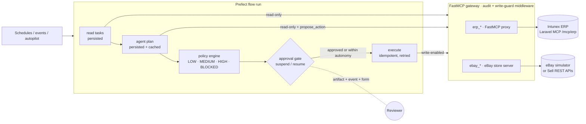

# agentic-ebay-store

[](https://github.com/jeremiahcarreon/agentic-ebay-store/actions/workflows/ci.yml)

An eBay store run by an AI agent, built on **Prefect** and **FastMCP**.

An existing production ERP MCP server ([Intunex](#connecting-the-real-intunex-erp), a Laravel
MCP endpoint) is wrapped with a FastMCP proxy and composed with an eBay store MCP server into
one gateway. A tool-using agent runs every part of the store (inventory, fulfilment, buyer
messages, returns, reputation, pricing, promotions, listings, store health) through
**durable Prefect flows**. Anything that touches buyers, money or listings passes through a
deterministic **policy engine** and, above the autonomy threshold, a **human approval gate**
that suspends the run until someone decides.



## Why it is built this way

| Concern | How it is handled |
|---|---|
| **The agent must not be able to change the store on its own** | The agent plans against a *read-only* gateway. Write tools are filtered out of its toolset *and* refused by `WriteGuardMiddleware`. Its only lever is a `propose_action` tool. Workflows execute approved proposals through a separate write-enabled gateway. |
| **The model must not decide its own blast radius** | `PolicyEngine` scores every proposal with plain, unit-tested rules: `LOW` / `MEDIUM` / `HIGH` / `BLOCKED`. Prices below the dealer floor, replies mentioning cost or margin, titles over 80 chars are **blocked**. Refund promises, public feedback replies, publishing and large price moves are **HIGH**. |
| **Humans approve without babysitting a process** | Approval gates *suspend* deployment runs (infrastructure released). Reviewers get a Markdown artifact with risk, rationale and evidence, an `ebay.agent.approval.requested` event for Slack/email automations, and a typed form. Unanswered gates time out as rejections. |
| **Resuming must not re-ask a non-deterministic model** | Reads and the agent plan are persisted task results cached per flow run. A resumed run reloads them (`Cached` state), reaches the *same* gate key, and gets the submitted decision. |
| **Nothing executes twice** | Proposal ids are content hashes. Execution is cached on *flow run + proposal id*, and the simulator's writes are idempotent. Retried or resumed runs reuse recorded results. |
| **No half-finished changes** | Listing publication (write content, then publish) runs in a Prefect **transaction**; an `on_rollback` hook restores the listing if publish fails. |
| **The agent should learn from reviewers, not nag them** | Every gate decision lands in `decisions.jsonl`. The planner sees recent decisions and reviewer notes for its domain, and a change a person rejected in the last 7 days is not proposed again. |
| **eBay rate limits across many schedules** | Every store write takes a slot on the `ebay-store-writes` Prefect global concurrency limit (`prefect gcl create ebay-store-writes --limit 2`); each deployment also has `concurrency_limit=1`. |
| **Runs without credentials** | Offline defaults: JSON-persisted eBay simulator, a mock ERP with the real tool surface, and deterministic per-domain planners when no LLM key is set. CI runs everything this way. |

## What the agent runs

| Flow (deployment) | Schedule | What it does | Typical risk |
|---|---|---|---|
| `inventory-sync` | 15 min | eBay quantity := ERP `available_to_sell` (capped at 25) | LOW, auto |
| `fulfillment-sync` | 30 min | Upload tracking for orders the ERP shows shipped | LOW when tracking is from the ERP |
| `buyer-messages` | 10 min + **KPI trigger** | Find order, read context, check stock/fitment, reply in house voice; escalate unknowns to the ERP product expert queue | MEDIUM (customer-facing) → human |
| `returns-desk` | hourly | Accept seller-fault returns and refund; decline only with reason | MEDIUM / HIGH |
| `reputation` | daily | Leave buyer feedback; answer negative feedback | LOW / HIGH (public, permanent) |
| `pricing` | daily | Small evidence-backed moves inside a dealer-protecting floor | LOW ≤5%, MEDIUM ≤15%, else HIGH |
| `promotions` | weekly | Markdown sale for slow movers on deep stock | MEDIUM ≤15% |
| `listing-builder` | daily | Draft → full listing from ERP specs, fitment, knowledge → publish (transactional) | HIGH |
| `store-health` | hourly | KPI artifacts; emits `ebay.store.kpi.breached` events | – |
| `store-autopilot` | on demand | All of the above, failure-isolated, as subflows or fanned out to deployments | – |

`buyer-messages` also starts the moment `store-health` reports waiting buyers: its deployment
has a `DeploymentEventTrigger` on `ebay.store.kpi.breached` matched to the
`unanswered_messages` KPI.

## Quick start

```bash
uv sync
uv run ebay-agent seed                         # create the simulator store
uv run ebay-agent run autopilot --simulate --approval auto
uv run ebay-agent status                       # KPIs after the run
```

### Human-in-the-loop, end to end

```bash
uv run prefect server start                    # terminal 1, UI at http://127.0.0.1:4200
uv run ebay-agent serve                        # terminal 2: all deployments
uv run prefect deployment run buyer-messages/buyer-messages
uv run ebay-agent pending                      # the run is Suspended at its gate
uv run ebay-agent approve <flow-run-id> --ids 5bac5c7819d9 --reviewer you
```

…or open the run in the Prefect UI, read the *Approval needed* artifact, and resume it with
the form. From a real run of exactly this sequence:

```
Flow run 'curly-oryx' - Suspending flow run, execution will be rescheduled when this flow run is resumed.
Flow run 'curly-oryx' - Finished in state Suspended(type=PAUSED)
   ... reviewer approves ...
Task run 'read erp_find_order' - Finished in state Cached(type=COMPLETED)
Task run 'read erp_check_stock' - Finished in state Cached(type=COMPLETED)
Task run 'plan messages' - Finished in state Cached(type=COMPLETED)
Flow run 'curly-oryx' - Gate 'Buyer messages': 2 approved, 0 rejected by jeremiah
Task run 'execute ebay_send_buyer_message' - Executed ebay_send_buyer_message(reply_to_message_id='MSG-1001',
  body='Hi classicc10! Good news: your order shipped via UPS, tracking 1Z999AA10123456799. ...')
Flow run 'curly-oryx' - Finished in state Completed()
```

The review artifact the approver sees:

| id | risk | action | why |
|---|---|---|---|
| `5bac5c7819d9` | 🟡 MEDIUM | `ebay_send_buyer_message(reply_to_message_id='MSG-1001', body='Hi classicc10! Good news: your order shipped via UPS, tracking 1Z999AA10123456799…')` | Answer classicc10: Where is my order? — Customer-facing message. |
| `05be5cc0692c` | 🟡 MEDIUM | `ebay_send_buyer_message(reply_to_message_id='MSG-1002', body="Hi mustang_sally68! Yes, RAD-259 is catalogued for the 1966 Ford Mustang. It's out of stock right now; our next shipment is due around …")` | Answer mustang_sally68: Fitment question on RAD-259 — Customer-facing message. |

### Docker

```bash
docker compose up --build    # Prefect UI :4200, served deployments, MCP gateway :8765/mcp
```

### Use the gateway from any MCP client

```bash
uv run ebay-agent mcp                                  # stdio, read-only
uv run ebay-agent mcp --transport http --port 8765     # streamable HTTP at /mcp
uv run fastmcp run src/ebay_agent/mcp/gateway.py:mcp   # via the FastMCP CLI
```

## Configuration

All settings are environment variables (prefix `EBAY_AGENT_`, nested with `__`). Every one
is optional; defaults run fully offline.

| Variable | Default | Meaning |
|---|---|---|
| `EBAY_AGENT_ERP_BACKEND` | `mock` | `mock` or `remote` (real Intunex endpoint) |
| `EBAY_AGENT_INTUNEX_MCP_URL` | `http://localhost/mcp/erp` | Intunex MCP endpoint |
| `EBAY_AGENT_INTUNEX_TOKEN` | – | Sanctum token, sent as `Authorization: Bearer` |
| `EBAY_AGENT_EBAY_BACKEND` | `simulator` | `simulator`, `sandbox` or `production` |
| `EBAY_AGENT_EBAY_CLIENT_ID` / `_CLIENT_SECRET` / `_REFRESH_TOKEN` | – | eBay OAuth (REST backends) |
| `ANTHROPIC_API_KEY` | – | Enables the LLM planner; without it the deterministic planners run |
| `EBAY_AGENT_ANTHROPIC_MODEL` | `claude-opus-5-5` | Planner model |
| `EBAY_AGENT_AGENT_EFFORT` | `medium` | Planner effort (`low` … `max`) |
| `EBAY_AGENT_USE_LLM` | `true` | Force the deterministic planners with `false` |
| `EBAY_AGENT_APPROVAL_MODE` | `prefect` | `prefect` (human), `auto` (policy only), `deny` (dry run) |
| `EBAY_AGENT_APPROVAL_TIMEOUT_SECONDS` | `86400` | Unanswered gates reject after this |
| `EBAY_AGENT_POLICY__AUTO_APPROVE_UP_TO` | `1` (LOW) | Autonomy level: `2` also auto-runs MEDIUM |
| `EBAY_AGENT_POLICY__MAX_AUTO_REFUND` | `75` | Refunds above this are HIGH |
| `EBAY_AGENT_POLICY__SMALL_PRICE_CHANGE_PCT` / `__LARGE_PRICE_CHANGE_PCT` | `5` / `15` | Pricing risk bands |
| `EBAY_AGENT_DATA_DIR` | `.data` | Simulator state and `audit.jsonl` |

## Connecting the real Intunex ERP

Intunex exposes its ERP to AI assistants as a Laravel MCP server: twelve tools (`find_order`,
`get_order`, `check_stock`, `get_pricing`, `lookup_product`, `find_fitment`,
`suggest_fan_pairing`, `search_product_knowledge`, `get_ebay_context`, `get_reply_feedback`,
`draft_ebay_reply`, `ask_product_expert`), Sanctum auth, per-tool permission checks, and the
rule that its writes are drafts a person approves. This project does not re-implement any
of it:

```python
upstream = Client(settings.intunex_mcp_url, auth=token)   # Authorization: Bearer <token>
erp = create_proxy(upstream, name="Intunex ERP")           # a local FastMCP server
gateway.mount(erp, namespace="erp")                         # erp_find_order, erp_check_stock, ...
```

Set `EBAY_AGENT_ERP_BACKEND=remote`, the URL and a token. Laravel MCP's `#[IsReadOnly]`
becomes `readOnlyHint`, which the gateway uses to classify upstream tools; anything that
does not declare itself read-only is treated as a write.

## eBay backends

`EbayRestStore` implements the store port over the Sell APIs: OAuth refresh-token grant with
token caching; Inventory API (inventory items, offers, publish/withdraw,
`bulk_update_price_quantity`); Fulfillment API (orders, shipping fulfilments); Post-Order API
(returns, decisions, refunds); Marketing API (markdown promotions). Buyer messaging and
feedback exist only in eBay's XML Trading API; those methods raise a clear error naming the
Trading call to implement, and the simulator covers them for the demo.

## Project layout

```
src/ebay_agent/
  config.py              typed settings (pydantic-settings)
  policy.py              Proposal, RiskAssessment, PolicyEngine
  ebay/                  domain models, EbayStore port, simulator, Sell REST client
  mcp/
    ebay_server.py       eBay store as a FastMCP server (tagged + annotated tools)
    intunex.py           FastMCP proxy to the Intunex ERP MCP endpoint
    intunex_mock.py      offline ERP with the identical tool surface
    gateway.py           composed gateway + audit and write-guard middleware
  agent/                 LLM planner, deterministic planners, persisted `plan` task
  workflow/              gateway client, approval gates, governed execution
  flows/                 one flow per store domain + autopilot
  deployments.py         schedules, triggers, concurrency limits
  cli.py                 `ebay-agent` command
tests/                   unit tests + end-to-end flow runs on a throwaway Prefect server
```

## Development

```bash
uv run pytest -q          # 61 tests, fully offline (spins up a throwaway Prefect server)
uv run ruff check src tests && uv run ruff format --check src tests
uv run mypy src
```

## License

MIT
